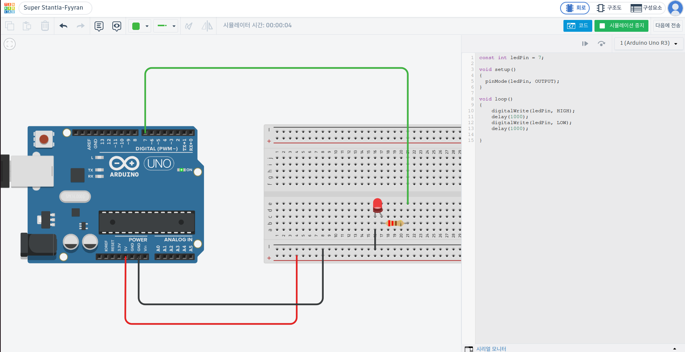

# 261114 실습 기술문서
- 일시: 2026-11-14(토), 로보틱스AI 수업 1강
- 작성자: 202035152 박민재

수업 내용과 당일 수행 내용, 실습 결과를 정리한 기술 문서입니다.

## 1. 수행 과정
> '로보틱스 AI: 로봇 자율주행, 고수준 판단과 저수준 제어' 수업의 오리엔테이션과 과정 개요, 임베디드 기초를 학습하고, TinkerCAD를 기반으로 LED 점멸 실습을 진행했습니다.

### 진행 내용
1. 오리엔테이션 및 로보틱스 모델의 고수준/저수준 구조 학습
2. MCU와 ESP32 학습
3. 임베디드 기초 용어 학습
4. 수업 장비에 개발 환경 구축
    - 작업 폴더 셋업, dialout 권한 설정, Arduino IDE 설치를 진행했습니다.
5. TinkerCAD Uno로 LED 점멸 실습 진행

## 2. 이론적 배경

### 2.1 로봇 구동 시스템 - 고수준과 저수준 역할 분리

자율주행 로봇 시스템이 성공적으로 주행하려면, 모터 제어, 센서 데이터 처리, 위치 추정과 경로 계획 등의 다양한 작업이 동시에 수행되어야 합니다. 이러한 기능들은 각각 필요한 연산량과 제어 주기가 다르기 때문에, 로봇 시스템은 고수준(High-Level)과 저수준(Low-Level)으로 역할을 분리하여 구성됩니다.

- 고수준(SBC, ROS2)
    - 상황 인식, 계획, 내비게이션
    - 판단, 의사결정(Decision-making), 자율성
    - 많은 연산이 필요함. 고연산이 가능한 하드웨어 사용
- 저수준(MCU, RTOS)
    - 모터, 인코더, 제어

### 2.2 고수준 의사 결정(High-Level Decision-Making)

고수준 의사 결정은 주로 SBC(Single-Board Computer)에서 ROS2 등을 실행하여 상황 인식, 경로 계획(Path Planning), 내비게이션 등의 판단을 담당합니다.

- 센서 데이터 처리 및 주변 환경 인식
- 위치 추정(Localization), 지도 작성(Mapping), SLAM
- 경로 계획(Path Planning) 및 내비게이션(Navigation)
- 카메라, LiDAR 등 대용량 센서 데이터 처리
- ROS2 기반의 여러 노드 실행

이러한 작업들은 높은 연산 성능과 메모리를 요구합니다. 저수준 기기는 메모리 제약이 매우 심해 몇 바이트, 몇 비트 수준인 경우도 있기 때문에, 고수준에서는 연산 성능이 높은 하드웨어를 사용합니다.

#### 고수준 하드웨어

- SBC: Jetson Orin Nano, 라즈베리파이 등
- 개인용 컴퓨팅 기기: 노트북, 데스크톱 등
- 데이터센터용 기기: 서버, 슈퍼컴퓨터 등

> SBC(Single-Board Computer): 하나의 기판에 컴퓨터 구성 요소가 모여 있는 소형 컴퓨터입니다. Linux 기반으로 다양한 소프트웨어와 고성능 연산 환경을 제공하며, 온디바이스 AI 수업에서 사용한 Jetson도 이에 해당합니다.

### 2.3 저수준 제어(Low-Level Control)

고수준이 판단과 계획을 담당하는 반면, 저수준 제어는 주로 MCU(Microcontroller Unit)에서 RTOS를 실행하여 실제 하드웨어를 빠르고 일정한 주기로 제어합니다. 로봇이 움직이려면 모터에 신호를 출력하고 엔코더와 센서의 값을 받아 오는 일이 계속 반복되어야 합니다.

- 모터 PWM 출력
- 엔코더(Encoder) 데이터 처리
- PID 제어(PID Control)
- 각종 센서 데이터 수집 및 전처리(IMU, Ultrasonic 등)
- GPIO, ADC/DAC, UART, I2C, SPI 등 직접적인 하드웨어 제어

위 작업은 모두 짧고 일정한 주기로 반복되어야 합니다. 이러한 주기를 안정적으로 지키기 위해 저수준 디바이스에서는 RTOS(Real-Time Operating System)를 사용합니다. RTOS는 매우 가볍고 특정 목적을 가진 OS로, MCU와 함께 사용하면 모터 제어와 같은 주기적인 작업을 안정적으로 수행할 수 있습니다.

#### 저수준 하드웨어(MCU)

이러한 저수준 제어를 수행하는 하드웨어는 MCU이며, 대표적으로 ESP가 있습니다. MCU는 저수준의 연산을 담당하며, 센서에서 들어오는 전압의 변화를 읽고 모터 같은 장치에는 전압을 생성하여 출력합니다. ESP는 Wi-Fi, Bluetooth 같은 무선통신이 가능하다는 특징이 있어 저가 CCTV 등에도 사용됩니다.

### 2.4 고수준-저수준 분리 이유

고수준은 많은 연산량이 필요하고, 저수준은 빠르고 일정한 제어 주기가 중요합니다. SBC는 Linux 기반이라 다양한 소프트웨어와 고성능 연산 환경을 제공하지만, 여러 프로세스가 동시에 실행되어 제어 주기가 변할 수 있습니다. 모터 제어처럼 주기가 일정해야 하는 작업은 MCU와 RTOS가 맡고 연산량이 큰 판단은 SBC가 맡도록 역할을 분리하면, 각 하드웨어의 장점을 활용할 수 있습니다.

#### 소프트웨어와 개발 언어

- 고수준: ROS2, Python/C++
- 저수준: 펌웨어/micro-ROS, C/C++

### 2.5 MCU와 ESP32

저수준 하드웨어로 소개한 MCU는 특정 제어 작업을 수행하는 소형 컴퓨팅 장치이며, 수업에서는 ESP32를 사용합니다. ESP32는 IoT 전문 기업 Espressif Systems가 개발한 저비용, 저전력 MCU 제품군입니다. CPU, 메모리와 다양한 주변장치(Peripheral)가 하나로 통합되어 있어 센서 데이터 수집과 모터 제어 같은 임베디드 시스템에 활용됩니다.

#### 임베디드 시스템

ESP32 같은 MCU를 기반으로 동작하며 특정 기능을 수행하도록 설계된 시스템을 임베디드 시스템이라고 합니다. 센서와 액추에이터에 직접 연결되어 물리적 환경과 상호작용하며, 자동차 제어 시스템, 산업용 로봇, IoT 디바이스, 의료기기 등에 활용됩니다. 연산량이 낮고 컴퓨터 자원이 제한되어 있지만, 실시간 처리와 제어에 적합합니다.

### 2.6 임베디드 기초 용어

#### 전기적 기초

MCU는 전압을 읽고 생성하는 장치이므로, 전압(Voltage), 전류(Current), 저항(Resistance)의 관계인 V = I × R이 모든 것의 기초입니다. 전류는 전압이 높은 곳에서 낮은 곳으로 흐르고, 저항이 있는 곳에는 전압이 발생합니다.

VCC는 전압이 발생하는 곳을, GND는 전류가 흘러가는 곳을 나타냅니다.

전압은 위치 에너지의 차이이므로 시스템 안의 모든 GND는 한 점에서 만나도록 연결해 통일해야 합니다. 이를 Common GND라고 하며, 시스템이 동작하지 않거나 센서 값이 튈 때는 Common GND를 먼저 확인해 보아야 합니다.

#### 신호의 종류와 논리 레벨

신호의 종류에는 아날로그(Analog)와 디지털(Digital)이 있습니다. 디지털 신호는 HIGH와 LOW로 해석하며, HIGH와 LOW를 구분하는 기준이 논리 레벨(Logic Level)입니다. 논리 레벨은 3.3V 또는 5V를 사용합니다.

#### MCU 입출력과 외부 장치 통신

- GPIO(General Purpose Input/Output): MCU의 입력(Input)과 출력(Output)을 담당하는 범용 핀
- PWM(Pulse Width Modulation): 디지털 출력을 응용한 방식이며, Duty Cycle과 Frequency를 사용
- ADC/DAC: 아날로그 입출력으로, ADC(Analog-to-Digital Converter)는 아날로그 신호를 디지털 값으로, DAC(Digital-to-Analog Converter)는 디지털 값을 아날로그 신호로 변환
- UART, I2C, SPI: 외부 장치와 통신하는 방식

## 3. 실습: TinkerCAD LED 점멸

### 3.1 목표와 회로

TinkerCAD 시뮬레이터에서 Arduino Uno R3의 디지털 7번 핀에 LED를 연결하고, 1초 간격으로 켜고 끄는 실습입니다.



### 3.2 전체 코드

```c
const int ledPin = 7;

void setup()
{
  pinMode(ledPin, OUTPUT);
}

void loop()
{
  digitalWrite(ledPin, HIGH);
  delay(1000);
  digitalWrite(ledPin, LOW);
  delay(1000);
}
```

### 3.3 결과 및 분석

시뮬레이션을 시작하면 LED가 1초 켜지고 1초 꺼지는 동작을 반복합니다.

HIGH를 출력하면 7번 핀, 저항, LED, GND 경로로 전류가 흘러 LED가 켜지고, LOW를 출력하면 꺼집니다.


## 4. 실행 방법

1. [TinkerCAD](https://www.tinkercad.com)에 로그인하고 새 회로를 만듭니다.
2. Arduino Uno R3, 브레드보드, LED, 220Ω 저항을 배치합니다.
3. Uno의 디지털 7번 핀을 저항에, 저항을 LED의 애노드에 연결합니다. LED의 캐소드는 브레드보드의 GND 레일에 연결하고, 이 레일을 Uno의 GND에 연결합니다.
4. 코드 편집기에 `practice_code_TinkerCAD.txt`의 내용을 붙여넣습니다.
5. 시뮬레이션을 시작하면 LED가 1초 간격으로 점멸합니다.

## 5. 필수 의존성

- TinkerCAD (웹 서비스, 별도 설치 불필요)

## 6. 파일 구조
- practice_code_TinkerCAD.txt : 실습 코드입니다. LED 전구를 1초 딜레이 간격을 두고 점멸시킵니다.
- simulator_result_image.png : 실습 결과 스크린샷입니다.