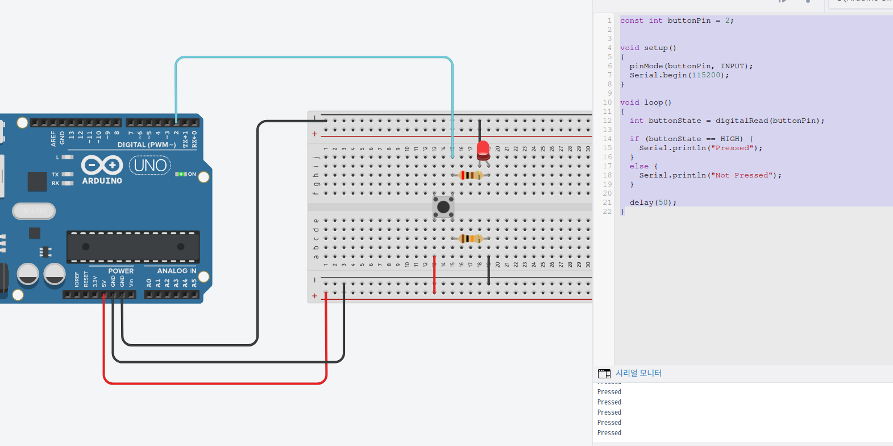
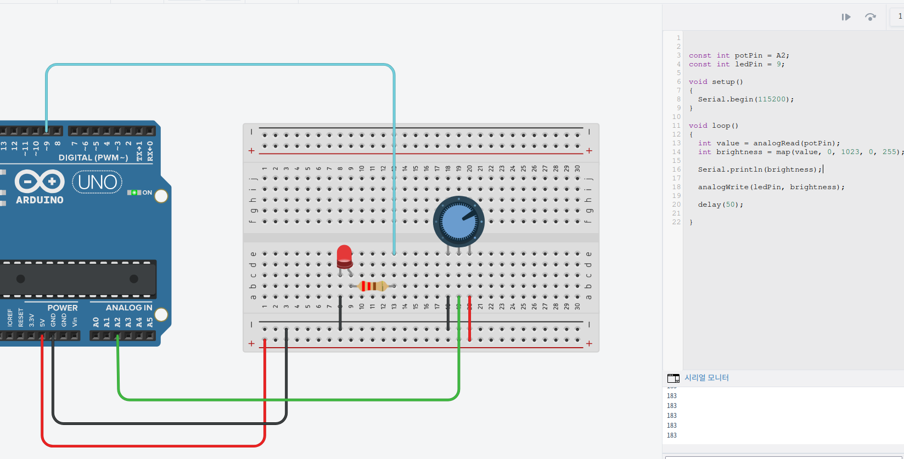

# 261115 실습 기술문서
- 일시: 2026-11-15(일), 로보틱스AI 수업 2강
- 작성자: 202035152 박민재

수업 내용과 당일 수행 내용, 실습 결과를 정리한 기술 문서입니다.

## 1. 수행 과정
> 레지스터와 풀다운·풀업 저항, 시리얼 통신, ADC와 PWM, 서보모터와 센서를 학습하고, TinkerCAD 버튼·가변저항 실습과 ESP32 서보모터 실습을 진행했습니다.

### 진행 내용
1. 레지스터, 풀다운·풀업 저항, 시리얼 통신 학습
2. TinkerCAD Uno로 버튼 상태 읽기, LED 토글, 가변저항 LED 밝기 조절 실습 진행
3. ADC와 PWM, 서보모터, 센서(IMU, LiDAR) 학습
4. 로봇 조립(팀원 담당)
5. ESP32로 서보모터 와이퍼, 가변저항 서보모터 제어 실습 진행

## 2. 이론적 배경

### 2.1 레지스터와 핀 입출력

MCU는 핀의 동작을 레지스터로 제어합니다. DDR(Data Direction Register)은 핀을 입력으로 쓸지 출력으로 쓸지 방향을 정하고, Output Register는 출력 핀의 상태를, Input Register는 입력 핀의 상태를 담습니다.

MCU는 입력 핀에 걸린 전압을 디지털 입력에서는 HIGH와 LOW 중 하나로 판정하고, ADC 입력에서는 숫자로 변환해 읽습니다.

### 2.2 풀다운·풀업 저항

버튼을 입력 핀에 저항 없이 연결하면, 버튼을 누르지 않은 동안 핀이 어디에도 연결되지 않은 floating 상태가 됩니다. 이때 핀의 전압이 일정하지 않아 버튼을 누르지 않아도 입력이 LOW로 유지되지 않습니다. 풀다운·풀업 저항은 버튼을 누르지 않았을 때의 기본 상태를 정합니다.

- 풀다운 저항(Pull-down Resistor): 입력 핀을 저항으로 GND에 연결. 누르지 않으면 LOW, 누르면 HIGH
- 풀업 저항(Pull-up Resistor): 입력 핀을 저항으로 VCC에 연결. 누르지 않으면 HIGH, 누르면 LOW

### 2.3 시리얼 통신

시리얼 통신의 속도는 초당 전송하는 비트 수(bit per second)인 Baud rate로 나타냅니다. 보내는 쪽과 받는 쪽의 Baud rate가 같아야 하므로, 코드에서 `Serial.begin(115200)`으로 설정했다면 시리얼 모니터도 115200으로 맞춰야 합니다.

시리얼 모니터에 값을 출력할 때는 `Serial.print`와 `Serial.println`을 사용하며, `Serial.print`는 줄바꿈 없이 출력하고 `Serial.println`은 출력한 뒤 줄바꿈을 적용합니다.

### 2.4 버튼 입력의 엣지와 바운싱

풀다운 저항을 연결한 버튼은 누르고 있는 동안 입력이 계속 HIGH입니다. 버튼을 누르는 순간은 입력이 LOW에서 HIGH로 바뀌는 시점이며, 이를 Rising Edge라고 합니다. 반대로 HIGH에서 LOW로 바뀌는 시점은 Falling Edge입니다. 버튼 토글은 Rising Edge에서 LED 상태를 한 번 반전합니다.

실제 버튼은 누르는 순간 접점이 짧은 시간 동안 여러 번 붙었다 떨어지는 바운싱(Bouncing)이 생기고, 이를 걸러내는 처리를 디바운싱(Debouncing)이라고 합니다.

### 2.5 ADC와 PWM

가변저항은 양 끝을 전원과 GND에, 가운데 단자를 입력 핀에 연결합니다. 다이얼을 돌리면 가운데 단자의 전압이 바뀌고, ADC가 이 전압을 숫자로 변환합니다. 변환 범위는 보드의 ADC 해상도에 따라 다릅니다.

- Arduino Uno: 10비트, 0–1023
- ESP32: 12비트(기본값), 0–4095

PWM(Pulse Width Modulation)은 HIGH와 LOW를 빠르게 반복하면서 한 주기 중 HIGH인 시간의 비율(Duty Cycle)을 조절하는 방식이며, 주파수(Frequency)는 주기의 역수입니다. Uno에서는 PWM 핀에 `analogWrite`로 0–255 값을 출력합니다. ADC 입력 0–1023을 PWM 출력 0–255에 맞추려면 `map` 함수로 범위를 변환하며, `map`은 범위를 벗어난 입력도 같은 비율로 변환합니다.

### 2.6 서보모터

서보모터의 목표 각도는 제어 신호의 펄스 폭으로 정해집니다. ESP32에서는 ESP32Servo 라이브러리의 `attach`로 신호 핀을 연결하고 `write`로 목표 각도를 지정하며, ESP32Servo에서는 20ms 주기(50Hz) 안의 544–2400µs 펄스 폭이 0–180°에 대응합니다.

### 2.7 센서와 외부 장치 연결

IMU(Inertial Measurement Unit)는 가속도계, 자이로, 지자기계로 구성됩니다. 가속도계는 가속도를, 자이로는 각속도를 측정하고, 지자기계는 자기장을 측정하므로 주변 자석의 영향을 받습니다. LiDAR는 레이저로 거리를 측정합니다.

외부 장치와의 통신에는 UART, I2C, SPI를 사용합니다. I2C는 SDA와 SCL 두 선을, SPI는 클록, 데이터, 장치 선택 신호를 사용합니다.

## 3. 실습

### 3.1 버튼 상태 읽기 (TinkerCAD)

D2 핀으로 버튼 상태를 읽어 시리얼 모니터에 출력하는 실습입니다. 풀다운 저항은 10kΩ, LED 직렬 저항은 200Ω을 사용했습니다.



```c
const int buttonPin = 2;


void setup()
{
  pinMode(buttonPin, INPUT);
  Serial.begin(115200);
}

void loop()
{
  int buttonState = digitalRead(buttonPin);
  
  if (buttonState == HIGH) {
   	Serial.println("Pressed"); 
  }
  else {
   	Serial.println("Not Pressed"); 
  }
  
  delay(50);
}
```

#### 결과 및 분석

버튼을 누르면 시리얼 모니터에 `Pressed`가, 놓으면 `Not Pressed`가 출력되고, LED는 버튼을 누르는 동안 켜집니다.

LED는 버튼 회로에 직접 연결되어 있어, 버튼을 누르면 5V가 200Ω 저항과 LED를 거쳐 GND로 흐르면서 켜집니다.

### 3.2 버튼으로 LED 토글 (TinkerCAD)

버튼을 누를 때마다 LED를 켜고 끄는 실습입니다. 풀다운 저항은 10kΩ, LED 직렬 저항은 220Ω을 사용했습니다.

https://github.com/user-attachments/assets/f6f3d37f-3914-4488-85d6-fa798d79d205

[원본 WebM 열기](./led_tinkerCAD/led_toggle.webm)

```c
const int ledPin = 7;
const int buttonPin = 2;
bool buttonFlag = false; // 버튼 토글 상태를 반영하기 위한 플래그

void setup()
{
  pinMode(ledPin, OUTPUT);
  pinMode(buttonPin, INPUT);
  Serial.begin(115200);
}

void loop()
{
  {
  int buttonState = digitalRead(buttonPin);
  
    
  if (buttonState == HIGH) { // 버튼 입력 시 플래그 전환
    Serial.println("Pressed"); 
    if (buttonFlag == true) { //True인 경우
    	buttonFlag = false;
      Serial.println("flip to false"); 
    } else { // False인 경우
     buttonFlag = true;
      Serial.println("flip to true"); 
    }
  }
  else {
   	Serial.println("Not Pressed"); 
  }
  
  Serial.println(buttonFlag);
  delay(50); // 버튼 입력이 여러번 중복 처리되는 것을 방지하기 위한 딜레이
    
    if (buttonFlag == true) { // 플래그에 따라 버튼 켜고 끄기
      digitalWrite(ledPin, HIGH);
    } else {
      digitalWrite(ledPin, LOW);
    }
    
   delay(50);
}
}
```

#### 결과 및 분석

버튼을 누르면 `buttonFlag`가 반전되고, 그 값에 따라 LED가 켜지거나 꺼집니다.

현재 버튼 상태가 HIGH인지만 확인하고 이전 상태와 비교하지 않기 때문에, 버튼을 누르고 있는 동안 루프(약 100ms)마다 플래그가 반전되는 문제가 있었습니다.

#### 코드 수정

이전 버튼 상태를 `lastButtonState`에 저장하고, LOW에서 HIGH로 바뀌는 Rising Edge에서만 플래그를 반전하도록 수정했습니다.

```c
const int ledPin = 7;
const int buttonPin = 2;
bool buttonFlag = false; // 버튼 토글 상태를 반영하기 위한 플래그
int lastButtonState = LOW;

void setup()
{
  pinMode(ledPin, OUTPUT);
  pinMode(buttonPin, INPUT);
  Serial.begin(115200);
}

void loop()
{
  int buttonState = digitalRead(buttonPin);

  if (buttonState == HIGH && lastButtonState == LOW) { // Rising Edge에서만 플래그 전환
    buttonFlag = !buttonFlag;
    Serial.println(buttonFlag);
  }
  lastButtonState = buttonState;

  if (buttonFlag == true) {
    digitalWrite(ledPin, HIGH);
  } else {
    digitalWrite(ledPin, LOW);
  }

  delay(50);
}
```

### 3.3 가변저항으로 LED 밝기 조절 (TinkerCAD)

가변저항 다이얼로 LED 밝기를 조절하는 실습입니다. LED 직렬 저항은 220Ω을 사용했습니다.



```c
const int potPin = A2;
const int ledPin = 9;

void setup()
{
  Serial.begin(115200);
}

void loop()
{
  int value = analogRead(potPin);
  int brightness = map(value, 0, 1023, 0, 255); // 0~255 범위로 매핑
  
  Serial.println(brightness);
  
  analogWrite(ledPin, brightness);
  
  delay(50);
  
}
```

#### 결과

다이얼을 돌리면 LED 밝기와 시리얼 출력값이 함께 바뀝니다.

### 3.4 서보모터 와이퍼 (ESP32)

for문으로 서보모터를 회전시키는 실습입니다.

```c
#include <ESP32Servo.h>

#define SERVO_PIN 14

Servo myServo;

void setup() {
  myServo.attach(SERVO_PIN);
  myServo.write(0);
}

void loop() {
  for (int position = 0; position < 180; position++) {
    myServo.write(position);
    delay(10);
  }
}
```

#### 결과

서보가 0°에서 179°까지 10ms마다 1°씩 회전한 뒤 0°로 돌아가는 동작을 반복합니다.

### 3.5 가변저항으로 서보모터 제어 (ESP32)

PCB에 부착된 가변저항의 값에 따라 서보모터 각도를 바꾸는 실습입니다.

```c
#include <ESP32Servo.h>

#define SERVO_PIN 14
#define POT_PIN 39

Servo myServo;


void setup() {
  myServo.attach(SERVO_PIN);
  myServo.write(0);
}

void loop() {

  int value = analogRead(POT_PIN);
  int position = map(value, 0, 1023, 0, 180);  // 가변저항 입력값을 서보모터 동작범위 180도로 매핑

  myServo.write(position);
  delay(10);
}
```

#### 결과 및 분석

기기에 코드를 배포했을 때, 가변저항 다이얼을 돌리면 전체 범위의 약 1/4 지점에서 서보가 180°에 도달하고, 그 뒤로는 움직이지 않다가 다이얼 끝부분에서 0° 근처로 되돌아가는 현상이 있었습니다. ESP32의 `analogRead`는 기본 0–4095를 반환하는데, 코드에서는 Uno 기준인 `map(value, 0, 1023, 0, 180)`을 사용해 `position`이 최대 720까지 커지고, ESP32Servo의 `write`는 500 이상의 값을 펄스 폭(µs)으로 처리하기 때문입니다.

#### 코드 수정

`map`의 입력 최댓값을 ESP32 ADC 범위에 맞춰 1023에서 올바른 값인 4095로 수정했습니다. ADC 값 0–4095 전체가 `position` 0–180에 대응하므로, `write`에는 항상 각도 범위의 값이 들어갑니다.

```c
#include <ESP32Servo.h>

#define SERVO_PIN 14
#define POT_PIN 39

Servo myServo;


void setup() {
  myServo.attach(SERVO_PIN);
  myServo.write(0);
}

void loop() {

  int value = analogRead(POT_PIN);
  int position = map(value, 0, 4095, 0, 180);  // 가변저항 입력값을 서보모터 동작범위 180도로 매핑

  myServo.write(position);
  delay(10);
}
```

## 4. 실행 방법

### TinkerCAD 실습 (3.1~3.3)

1. [TinkerCAD](https://www.tinkercad.com)에 로그인하고 새 회로를 만듭니다.
2. Arduino Uno R3와 브레드보드에 각 실습의 회로를 구성합니다.
3. 코드 편집기를 텍스트 모드로 바꾸고 해당 실습의 코드를 붙여넣습니다.
4. 시뮬레이션을 시작하고 시리얼 모니터에서 출력을 확인합니다.

### ESP32 실습 (3.4~3.5)

1. Arduino IDE에 ESP32 보드 패키지와 ESP32Servo 라이브러리를 설치합니다.
2. 보드는 D1 R32를, 포트는 ESP32가 연결된 USB 포트를 선택합니다. 수업 장비(Linux)에서는 `dialout` 권한이 있어야 `/dev/ttyUSB0` 포트를 열 수 있습니다.
3. 서보 신호선을 GPIO14, 전원선을 5V, 접지선을 GND에 연결합니다.
4. `servo_test/servo_wiper/servo_wiper.ino` 또는 `servo_test/servo_potentiometer/servo_potentiometer.ino`를 열어 업로드합니다.

## 5. 필수 의존성

- TinkerCAD (웹 서비스, 별도 설치 불필요)
- Arduino IDE
- ESP32 보드 패키지 (Arduino IDE 보드 매니저)
- ESP32Servo 라이브러리 (Arduino IDE 라이브러리 매니저)

## 6. 파일 구조
- `led_tinkerCAD`: TinkerCAD 실습 결과 이미지와 동영상 폴더입니다.
    - `led_press.png`: 버튼 상태 읽기 결과
    - `led_toggle.webm`: 버튼 LED 토글 결과
    - `led_brightness.png`: 가변저항 LED 밝기 조절 결과
- `servo_test`: Arduino IDE에서 작성한 서보모터 실습 코드 폴더입니다.
    - `servo_wiper`: for문으로 서보모터를 회전시키는 코드
    - `servo_potentiometer`: 가변저항 값에 따라 서보모터를 회전시키는 코드
